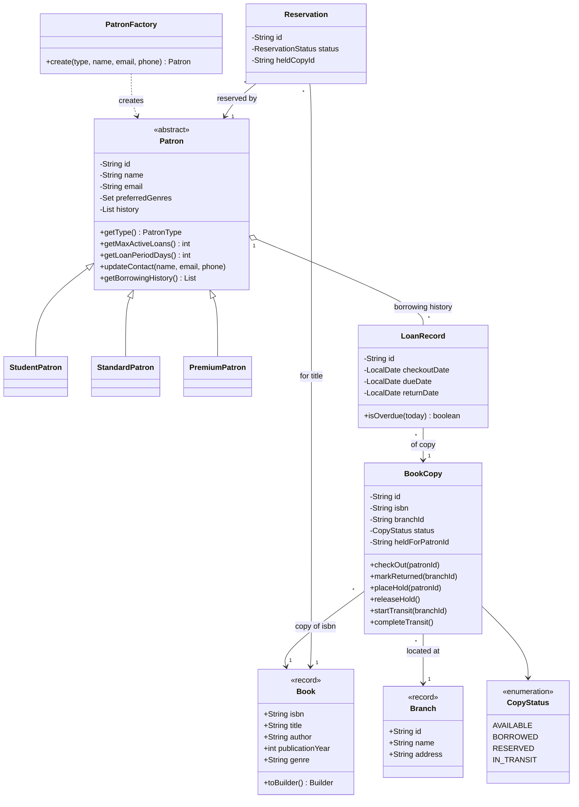
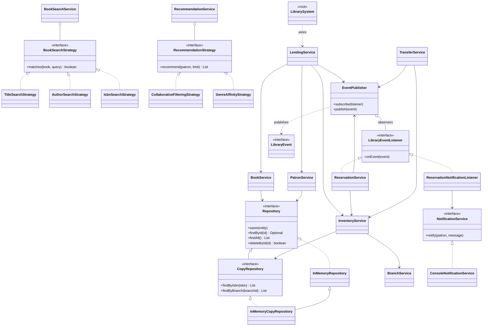
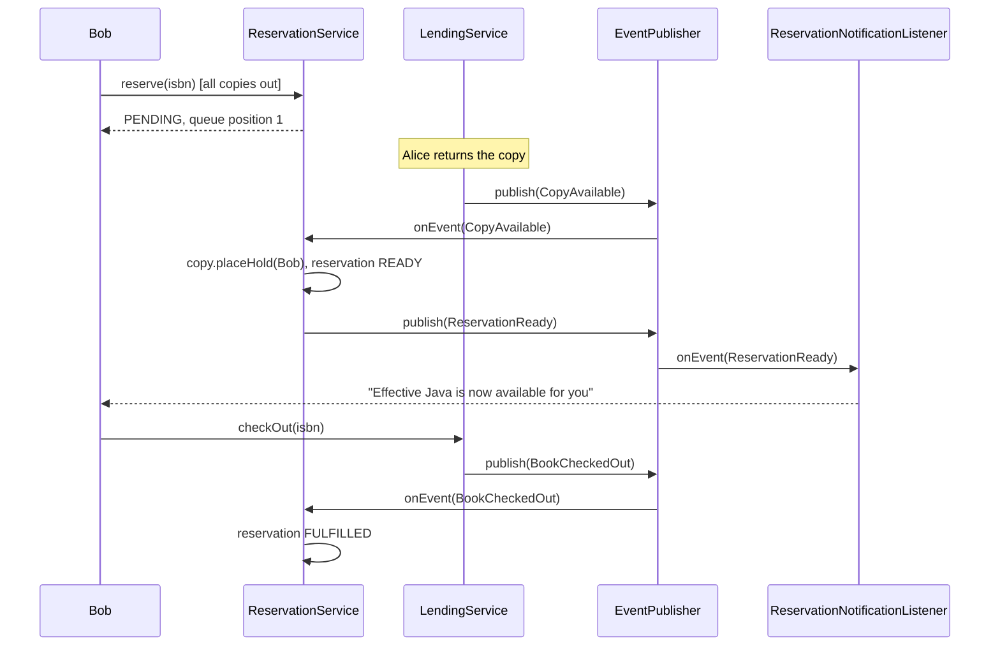

# Library Management System

A dependency-free Java 17 library system covering the full core scope **and all three optional extensions**
(multi-branch support with transfers, reservations with notifications, and recommendations).

| Area | What is implemented |
|---|---|
| **Books** | `Book` (title, author, ISBN, year, genre); add / update / remove; search by title, author or ISBN |
| **Patrons** | `Patron` hierarchy (Student, Standard, Premium); register, update contact details and genre preferences; full borrowing history |
| **Lending** | Checkout and return with loan limits, per-type loan periods, overdue blocking |
| **Inventory** | Physical `BookCopy` objects with a status (available, borrowed, reserved, in transit); per-branch and per-title reports |
| **Multi-branch** | Any number of branches; copies can be returned at any branch; two-step transfers (dispatch, then receive) |
| **Reservations** | FIFO queue per title; copy is placed on hold when it becomes free; patron is notified (Observer) |
| **Recommendations** | Collaborative filtering + genre/author affinity, ranked with a bounded min-heap |

## Quick start

Requires **JDK 17+**. No third-party libraries are needed.

```bash
./build.sh              # compile + run the test suite (22 tests)
./build.sh demo         # compile + run the end-to-end demo (add `debug` for FINE-level logs)
```

Or with Maven: `mvn compile exec:java -Dexec.mainClass=com.library.Main`.

## Design overview

```
com.library
├── domain          Book, BookCopy, Patron (+3 subclasses), PatronFactory, LoanRecord, Reservation, Branch
├── repository      Repository<T,ID>, InMemoryRepository, CopyRepository (+ isbn index)
├── search          BookSearchStrategy (Title / Author / Isbn), BookSearchService
├── event           LibraryEvent (sealed), LibraryEventListener, EventPublisher
├── notification    NotificationService, ConsoleNotificationService, ReservationNotificationListener
├── recommendation  RecommendationStrategy (Collaborative / GenreAffinity), TopK, RecommendationService
├── service         Book, Patron, Inventory, Lending, Reservation, Transfer, Branch services
├── util            LogConfig
├── LibrarySystem   composition root (all wiring in one place)
└── Main            demo
```

Two ideas shape the model:

* **`Book` vs `BookCopy`.** A `Book` is catalogue data (one per ISBN, immutable). A `BookCopy` is a physical item that
  lives in one branch and has a state. This is what makes multi-copy inventory, branch transfers and reservations natural.
* **Event-driven side effects.** Services publish events (`CopyAvailable`, `BookCheckedOut`, ...). The reservation logic
  and notifications are listeners, so lending and transfer code never has to know that reservations exist.

### Class diagram — domain model



### Class diagram — services, strategies and events



### Reservation flow (Observer in action)



## Technical requirements checklist

### OOP concepts

| Concept | Where |
|---|---|
| **Inheritance** | `Patron` → `StudentPatron` / `StandardPatron` / `PremiumPatron`; `InMemoryCopyRepository` extends `InMemoryRepository`; domain exceptions extend `LibraryException` |
| **Polymorphism** | Lending code calls `patron.getMaxActiveLoans()` / `getLoanPeriodDays()` without knowing the concrete type; strategies and repositories are used through interfaces |
| **Encapsulation** | `BookCopy` owns its state machine (illegal transitions throw); `Patron` exposes history and genres only as unmodifiable views; `Book` is an immutable record with validation |
| **Abstraction** | `Repository`, `NotificationService`, `BookSearchStrategy`, `RecommendationStrategy`, `LibraryEventListener` hide implementations behind small contracts |

### SOLID

* **S — Single Responsibility.** One service per concern: `BookService` (catalogue), `InventoryService` (copies),
  `LendingService` (loans), `ReservationService` (queue), `TransferService` (branch moves), `BookSearchService` (queries).
  `Book` holds data, `BookCopy` holds copy state, `LoanRecord` holds one loan.
* **O — Open/Closed.** New search field → new `BookSearchStrategy`. New recommendation algorithm → new
  `RecommendationStrategy`. New patron tier → new `Patron` subclass + one factory case. New reaction to an event →
  new listener. None of these modify existing services.
* **L — Liskov Substitution.** Any `Patron` subtype can be used wherever `Patron` is expected; every strategy and
  repository implementation honours its interface contract (e.g. recommendations never include already-borrowed books).
* **I — Interface Segregation.** Small, focused interfaces: `LibraryEventListener` has one method, `NotificationService`
  has one, `CopyRepository` adds only the two queries the generic `Repository` lacks.
* **D — Dependency Inversion.** Services depend on `Repository`, `NotificationService` and `Clock` abstractions.
  Concrete classes are chosen in exactly one place, `LibrarySystem`. Tests replace the clock and the notification channel.

### Design patterns (5 used)

| Pattern | Where | Why |
|---|---|---|
| **Strategy** | `BookSearchStrategy` (title / author / ISBN) and `RecommendationStrategy` (collaborative / genre affinity) | Swap or add algorithms without touching the callers |
| **Observer** | `EventPublisher` + `LibraryEventListener`; `ReservationService` and `ReservationNotificationListener` subscribe | Decouples lending/transfer from reservations and notifications; a failing listener is logged and cannot break the publisher |
| **Factory** | `PatronFactory` | Centralises construction, id generation and the type → class mapping |
| **Builder** | `Book.Builder` (`toBuilder()` for copy-with-changes) | Readable construction of an immutable 5-field record; "update" without mutation |
| **Repository** | `Repository<T,ID>` and in-memory implementations | Storage can be replaced (e.g. by a database) without changing services |

### Java collections

| Collection | Use |
|---|---|
| `Map` (`LinkedHashMap`, `HashMap`, `EnumMap`, `TreeMap`) | Repositories (id → entity); active loans by copy id; strategy registry keyed by `SearchType`; inventory reports |
| `Map<String, Set<String>>` | Secondary index isbn → copy ids in `InMemoryCopyRepository` (O(1) per-title lookup) |
| `Set` (`LinkedHashSet`, `HashSet`) | Patron genre preferences (no duplicates, stable order); borrowed-ISBN sets for Jaccard similarity |
| `List` | Borrowing history (ordered), search results, recommendations |
| `Deque` (`ArrayDeque`) | FIFO reservation queue per ISBN |
| `PriorityQueue` | Bounded min-heap that keeps the top-k recommendations in O(n log k) |
| `CopyOnWriteArrayList` | Listener list in `EventPublisher` (safe to iterate while listeners subscribe) |

### Logging

Uses `java.util.logging` (part of the JDK, so the project has no dependencies to install). `LogConfig.init(Level)`
sets a one-line format. Every service logs significant events at `INFO` (checkout, return, hold, transfer, ...),
listener failures at `SEVERE` with stack trace, and search / event-bus tracing at `FINE` (`./build.sh demo debug`).
Business-rule violations are raised as typed exceptions rather than logged-and-swallowed.

Example (reservation flow):

```
RESERVE R-0001: Carol Diaz queued for 9780134685991 (position 1)
RETURN L-00001: copy C-0001 returned to MAIN
HOLD copy C-0001 held for P-0003 (R-0001)
NOTIFY Carol Diaz <carol@example.com>: "Effective Java" is now available for you at branch MAIN.
CHECKOUT L-00005: Carol Diaz borrowed 9780134685991 (copy C-0001) from MAIN, due 2026-10-28
Reservation fulfilled: R-0001
```

## Behaviour and rules

* **ISBN** is normalised (hyphens/spaces removed) and validated as 10 or 13 characters; it is the unique catalogue key.
* **Removing a book** deletes its copies, but is refused if any copy is borrowed, on hold or in transit. Open
  reservations for the title are cancelled.
* **Patron types:** Student = 3 loans / 14 days, Standard = 5 / 21, Premium = 10 / 30. Email must be unique.
* **Checkout** is refused when the patron is at their loan limit, has an overdue loan, or no free copy exists at that branch.
  A copy on hold can only be borrowed by the patron it is held for.
* **Return** can be made at any branch; the copy then belongs to that branch.
* **Reservations** are only accepted when no copy is currently free. When a copy becomes free (return, transfer
  received, new copy added, or a hold cancelled) the first `PENDING` patron in the queue gets it.
* **Transfers:** only `AVAILABLE` copies can be dispatched; while `IN_TRANSIT` a copy cannot be lent.
* **Recommendations:** `RecommendationService` asks `CollaborativeFilteringStrategy` first (patrons with overlapping
  history, Jaccard similarity) and tops up from `GenreAffinityStrategy` (history + stated preferences). New patrons with
  preferences still get results; patrons with neither get an empty list.

## Testing

`src/test/java/com/library/LibrarySystemTest.java` — 22 tests, run by `./build.sh`. It uses a tiny built-in harness (no
JUnit) so the project builds offline with only a JDK. Tests inject a `MutableClock` (to simulate overdue loans) and a
recording `NotificationService`. They cover catalogue rules, search, patron rules, checkout/return, loan limits, overdue
blocking, inventory reports, the full reservation lifecycle (FIFO, hold, cancel, fulfil), transfers, and both
recommendation strategies.

## Assumptions and limitations

* Data is **in memory** only. Persistence would mean adding a new `Repository` implementation (e.g. JDBC/JPA); no service changes.
* No fines, and held books **do not expire** — both would be natural next steps (a scheduled job publishing events).
* Services use coarse `synchronized` methods around the lending and reservation critical sections, which is correct for a
  single JVM but is not a distributed-safe design.
* `java.util.logging` was chosen over SLF4J/Logback purely to keep the project dependency-free; swapping is a
  mechanical change because every class logs through a single `Logger` field.
